# CosmicForge HealthNet Centralized Admin

# Marketing Intelligence Phase 2: Complete Architecture and Implementation

**Canonical engineering, deployment, live-validation, operations, risk, and acceptance reference**
**Revision:** 1.0
**Date:** 2026-07-19
**Repository:** `ADMIN-Backend`
**Release posture:** Engineering complete; five-provider live validation pending

| Revision | Date | Scope | Status |
|---|---|---|---|
| 1.0 | 2026-07-19 | WP0 through Sections 22-26 | Controlled release candidate |

## Table of contents

1. Executive overview
2. Scope, constraints, and non-goals
3. Delivery work packages
4. System context
5. Component architecture
6. Data architecture
7. Provider capability architecture
8. Provider ingestion
9. Attribution and funnel reconciliation
10. Creative synchronization and scoring
11. Calculation and currency policy
12. Recommendation architecture
13. Alert architecture
14. Task integration architecture
15. Experiment architecture
16. Settings architecture
17. Scheduler and evaluation architecture
18. API architecture
19. RBAC and audit
20. Validation, security, and privacy
21. Error handling and observability
22. Testing architecture
23. Deployment architecture
24. Six-stage rollout
25. Live-provider validation
26. Operations runbook
27. Troubleshooting guide
28. Risk register
29. Final Definition of Done
30. Appendices

## 1. Executive overview

Marketing Intelligence Phase 2 is a read-only-provider, deterministic decision-support subsystem in the Centralized Admin backend. It ingests advertising campaign and creative evidence from Meta, TikTok, X, LinkedIn, and Google Ads; reconciles internal attribution and monetary events; scores creatives; generates advisory recommendations and alerts; tracks experiments; and converts accepted recommendations into the existing Task model.

The implementation deliberately does not mutate provider campaigns. It does not perform FX conversion, forecasting, multi-touch attribution, experiment execution, or mandatory LLM inference. Phase 1 campaign synchronization remains an independent operational path.

The deployment-level kill switch is `MARKETING_INTELLIGENCE_PHASE2_ENABLED=false`. With the master disabled, Phase 2 schedulers and operational execution are disabled while reads, settings configuration, connection preparation, validation evidence, OAuth preparation, attribution event production, and Phase 1 synchronization remain available under their existing RBAC/security policies.

### Acceptance posture

| Dimension | Status | Basis |
|---|---|---|
| Engineering | COMPLETE | Source, schema, migrations, and automated tests |
| Database | COMPLETE | 21-migration manifest and empty-database replay |
| Security | COMPLETE | Secret scan, network guard, RBAC, bounded serializers |
| Documentation | COMPLETE | This canonical document plus runbook, matrix, and checklist |
| Live provider evidence | LIVE_VALIDATION_PENDING | No explicit live permission or validated credentials supplied |
| Production release | STAGE 1 ONLY | Dark launch permitted; platform enablement requires its own live gate |

## 2. Scope, constraints, and non-goals

### In scope

- Provider connection and capability inspection.
- Campaign and creative ingestion using read-only provider APIs.
- Internal click, signup, activation, payment, refund, and chargeback reconciliation.
- Currency-safe deterministic scoring, fatigue, recommendation, and alert rules.
- Recommendation/alert/experiment lifecycles.
- Atomic conversion to the existing Task, Notification, audit, and realtime infrastructure.
- Typed settings, locks, heartbeats, scheduled evaluation, run ledger, RBAC, observability, and release controls.

### Locked non-goals

- No campaign, ad, creative, bid, or budget mutation.
- No FX conversion or cross-currency monetary aggregation.
- No predictive forecasting, ML model, multi-touch attribution, or autonomous experiment execution.
- No required LLM call; `llmCommentaryEnabled` remains reserved and false.
- No duplicate Task, Notification, WebSocket, scheduler, settings, or provider-platform system.
- No coupling of paid Marketing Intelligence to Social Operations publishing.

## 3. Delivery work packages

### 3.1 Dependency order

`WP0 -> WP1 -> WP2 -> WP3 -> WP4/WP5 -> WP6/WP8/WP9 -> WP7 -> WP10 -> WP11 -> WP12`

Recommendation rules consume resolved settings and persisted scoring inputs. Task conversion requires an accepted recommendation. Full evaluation resolves settings, uses the existing connector/lock services, and does not bypass component rules. Phase 1 sync is registered separately.

### 3.2 Final work-package matrix

| WP | Status | Code | Database/API | Tests | Live validation | Remaining action |
|---|---|---|---|---|---|---|
| WP0 | COMPLETE | event producers, attribution, adjustment, redaction, lock renewal | attribution/funnel/identity/run fields | WP0, revenue, event tests | Not required for code acceptance | Monitor source integrations |
| WP1 | COMPLETE | Prisma schema and repositories | settings, creatives, scores, runs, recommendations, alerts, experiments | schema/migration tests | Not applicable | None |
| WP2 | COMPLETE | `creative.connector.interface.js`, registry | normalized DTOs and capability output | connector contract tests | Pending provider confirmation | Record limitations |
| WP3 | LIVE_VALIDATION_PENDING | five provider adapters | catalog/insight ingestion | mock connector tests | Credentials/approval required | Run one platform gate at a time |
| WP4 | COMPLETE_WITH_CONFIGURATION | creative sync/scoring/fatigue | durable snapshots and score history | creative suites | Observation required | Enable validated connections only |
| WP5 | COMPLETE | typed settings services/controllers | settings APIs and versioned rows | settings suites | Not applicable | Configure targets per currency |
| WP6 | COMPLETE_WITH_CONFIGURATION | recommendation rules/confidence/lifecycle | recommendation APIs and dedupe | recommendation suites | Quality review required | Stage 4 enablement |
| WP7 | COMPLETE_WITH_CONFIGURATION | recommendation Task adapter | existing Task/Notification/audit | Task suites | Operational verification required | Configure eligible assignee |
| WP8 | COMPLETE_WITH_CONFIGURATION | alert rules/recovery/delivery | alert APIs and Notification link | alert suites | Cooldown/no-spam review required | Stage 4 enablement |
| WP9 | COMPLETE | experiment tracking service | experiment APIs/state | experiment suites | No provider execution | None |
| WP10 | COMPLETE_WITH_CONFIGURATION | schedulers/full evaluation/locks/runs | evaluation-run APIs | scheduler/lock/run tests | Stage observation required | Enable only after gates |
| WP11 | COMPLETE | RBAC, validation, errors, logging, privacy | protected APIs/audits | security/network tests | Not applicable | Ongoing review |
| WP12 | LIVE_VALIDATION_PENDING | master flag, live CLI, docs | release artifacts | final regression/docs tests | Five gates not run | External live validation |

### 3.3 Evidence map

| Capability | Implementation | Model/migration | Tests | Documentation |
|---|---|---|---|---|
| Attribution | `attribution.service.js`, funnel listener | attribution/funnel/identity models; WP0 migration | attribution, funnel, WP0 | Sections 9, 11 |
| Provider normalization | `creative.connector.interface.js`, `creative.registry.js` | creative tables | connector/ingestion tests | Sections 7-8 |
| Scoring/fatigue | creative scoring/rules/fatigue services | score snapshots | creative scoring tests | Sections 10-11 |
| Recommendations | recommendation services/repository | recommendations | recommendation tests | Section 12 |
| Alerts | alert services/repository/adapter | alerts | alert tests | Section 13 |
| Tasks | `recommendation-task.adapter.js` | existing `Task` | Task tests | Section 14 |
| Operations | scheduler registry, locks, run ledger | evaluation runs/locks | scheduler/lock tests | Sections 17, 26 |
| Release controls | `phase2-feature.js`, live CLI | no migration | Sections 22-26 tests | Sections 23-25 |

## 4. System context

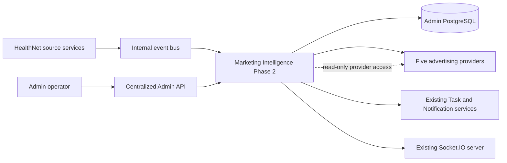

The Admin API is the trust boundary for manual operations. Internal funnel events enter through authenticated service routes/event producers. Provider APIs are read-only sources. PostgreSQL is the durable system of record. Task, Notification, audit, and WebSocket delivery reuse existing modules.

## 5. Component architecture

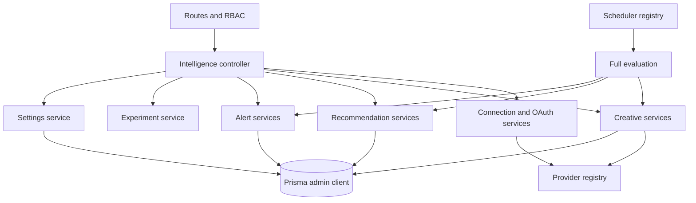

Major module roots are `src/modules/marketing/intelligence`, `src/shared/events`, `src/shared/middlewares`, `src/shared/utils`, and the generated Admin Prisma client. Social Operations remains a sibling subsystem, not a provider implementation dependency.

## 6. Data architecture

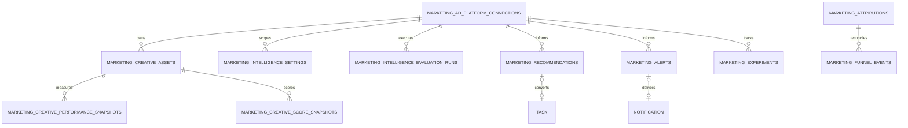

### Persistence invariants

- Connection/platform account identities are unique.
- Creative `sourceKey` and metric identities make re-fetches idempotent.
- Scores are unique by asset, analysis window, and rule version.
- Recommendation/alert dedupe keys preserve active lifecycle identity.
- Historical connection relationships generally use `SetNull` or `Restrict`; deleting a connection does not erase analytical history.
- Task conversion is one-to-one through `convertedToTaskId`.
- Run summaries and provider-derived JSON are bounded and sanitized before persistence.

### Migration ownership

Phase 2A is the WP0 correction migration. Phase 2B comprises Sections 7, 8, and 9. Phase 2C comprises Sections 10-13, their audit correction, and Sections 14-17. Sections 18-26 require no corrective schema migration.

## 7. Provider capability architecture

| Platform | Credential mode | Catalog grain | Insights | Pagination | Refresh | Currency/micro-units | Stable creative identity | Current live status |
|---|---|---|---|---|---|---|---|---|
| META | OAuth token / encrypted connection | Ad with creative metadata | Daily ad insights | Graph cursor | OAuth reauthorization | Major-unit spend; connection currency | native creative ID or `ad:<id>` | CREDENTIALS_REQUIRED |
| TIKTOK | Access/refresh token | Ad with optional creative ID | Auction-ad daily report | Page number | Supported | Major-unit spend; connection currency | creative ID, otherwise ad ID | CREDENTIALS_REQUIRED |
| X | OAuth 1.0a plus Ads approval | Promoted entity | Daily billing/engagement | Cursor | Credential rotation | Billing micro-units converted once | tweet/promoted entity ID | CREDENTIALS_REQUIRED |
| LINKEDIN | OAuth token/refresh token | Full creative URN | Creative-pivot analytics | Start/count | Supported | Local-currency spend | full creative URN | CREDENTIALS_REQUIRED |
| GOOGLE_ADS | OAuth refresh plus developer token | Ad/resource name | GAQL ad metrics | Page token | Supported | `cost_micros` converted once | ad resource name/ID | CREDENTIALS_REQUIRED |

Provider records are normalized into bounded DTOs. Raw response bodies may be encrypted/sanitized for approved ingestion tables but are not returned by public APIs, run summaries, documents, or logs.

## 8. Provider ingestion

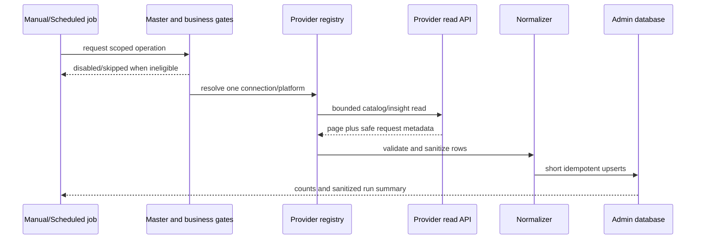

Ingestion validates one provider account and bounded date range per connection. Pagination is explicit. Retry is limited to retryable timeout, rate-limit, and temporary-provider failures. Token refresh is connector-specific and refreshed values are re-encrypted through the connection service. Provider writes do not exist.

## 9. Attribution and funnel reconciliation

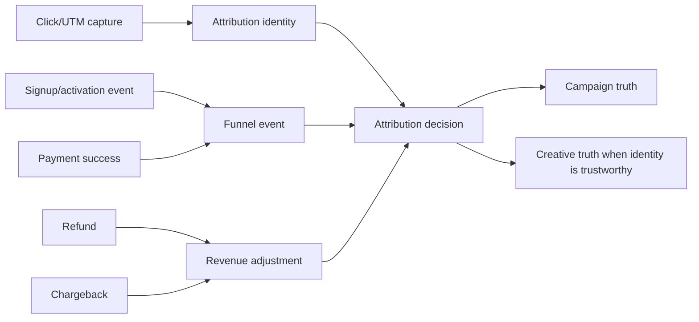

Event identities are deduplicated. A repeated immutable external ID with conflicting immutable facts returns `DUPLICATE_ACTION`. Refunds and chargebacks reduce internal net revenue without rewriting the original payment. Campaign-only evidence is not duplicated into creative attribution. Provider conversions remain informational.

Attribution uses documented deterministic precedence and window boundaries, not probabilistic multi-touch allocation. When evidence is ambiguous, the record remains campaign-only or unavailable.

## 10. Creative synchronization and scoring

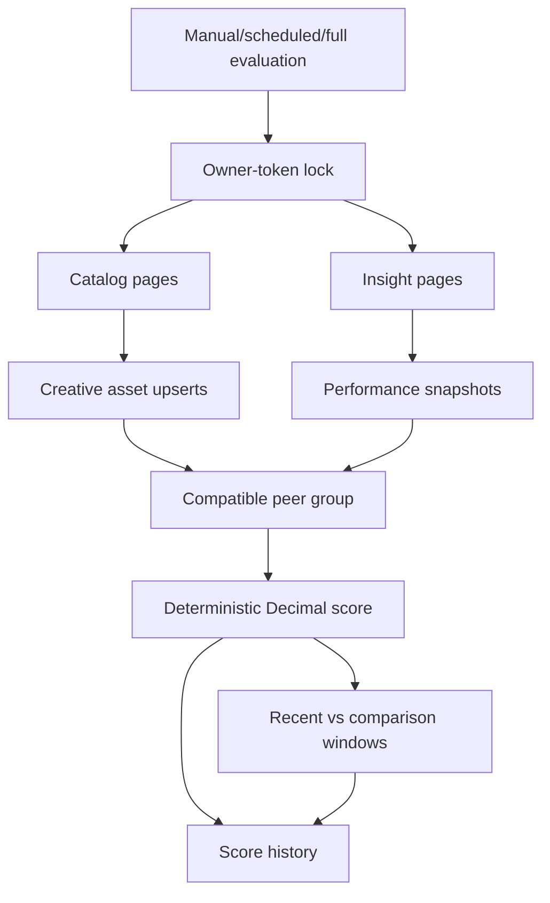

Creative synchronization never fabricates a missing metric. Scores use compatible peers or configured targets, renormalize only available components, and cap metadata modifiers. Data sufficiency is `INSUFFICIENT`, `LIMITED`, `SUFFICIENT`, or `STRONG`. Fatigue requires sufficient volume and consecutive confirming windows; rerunning the same window does not advance a streak.

## 11. Calculation and currency policy

| Metric | Definition | Unavailable when |
|---|---|---|
| CTR | clicks / impressions | impressions is zero/missing |
| CPC | spend / clicks | clicks zero or currency unavailable |
| CPM | spend / impressions x 1,000 | impressions zero or currency unavailable |
| Conversion rate | trustworthy internal goals / clicks | denominator/evidence unavailable |
| CPA | spend / trustworthy internal goals | denominator/currency unavailable |
| ROAS | net trustworthy attributed revenue / spend | spend zero or currencies incompatible |

Prisma Decimal is used for money, ratios, thresholds, confidence, and score math. Division by zero yields unavailable, not infinity or an invented zero. Google Ads and X micro-unit values are converted exactly once at the adapter boundary. Monetary totals are never combined across currencies. There is no FX service.

## 12. Recommendation architecture

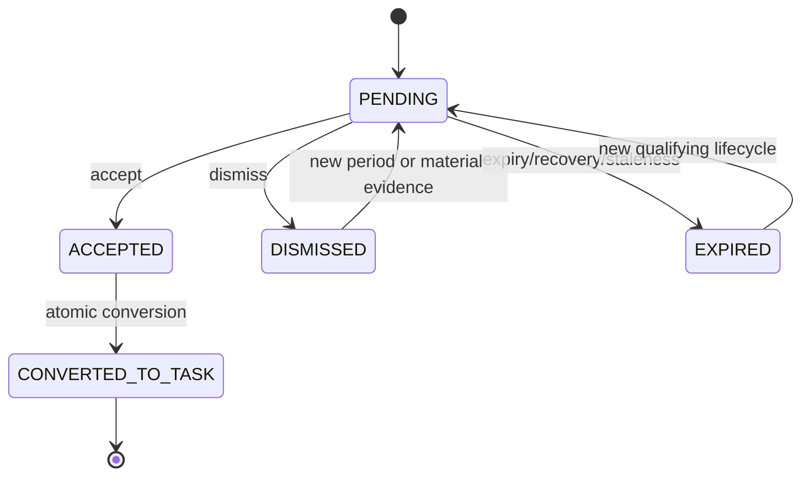

Rules create `PAUSE`, `SCALE`, `REALLOCATE_BUDGET`, and `CREATE_CONTENT` advice only. Confidence is deterministic and evidence-backed. Canonical condition identities, period buckets, evidence fingerprints, recovery streaks, and expiry prevent duplicate or stale advice. Accept/dismiss transitions validate active actors and current status in the service, not only the route.

No recommendation calls a provider mutation API. `suggestedAction` describes operator review and remains capped by `maximumRecommendedScalePct=0.20`.

## 13. Alert architecture

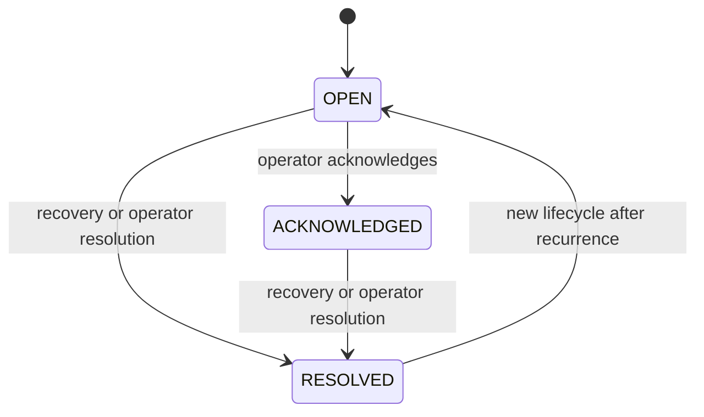

Alert types cover CPA breach, spend without conversion, conversion-rate decline, creative fatigue, campaign deterioration/high performance, stale sync, token refresh, degraded connection, and provider permission failures. Active dedupe identity, cooldown, occurrence count, severity escalation, persistence evaluation, and recovery evaluation prevent spam.

Persistence succeeds before Notification and realtime delivery. Delivery failure is sanitized and does not remove the alert. Health and performance rule groups have independent schedules and locks.

## 14. Task integration architecture

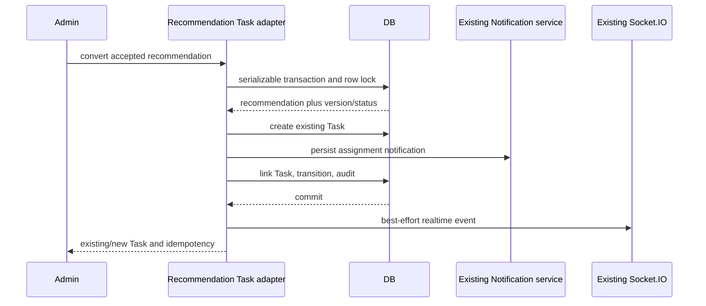

The real schema has `Task.assigneeId`. There is no `TaskAssignee` model, Task priority field, or Task metadata field. Operational urgency is a bounded line in the Task description, not an invented database property.

Assignee order is request override, connection setting, global setting, then deterministic eligible Marketing fallback. A repeat returns the linked Task without another Task, Notification, or transition audit. A missing linked Task is an integrity conflict.

### Task conversion request

```json
{
  "assigneeAdminUserId": "11111111-1111-4111-8111-111111111111",
  "dueDate": "2026-07-25T17:00:00.000Z"
}
```

Both fields are optional. `dueDate` is an ISO-8601 timestamp with an explicit timezone.

## 15. Experiment architecture

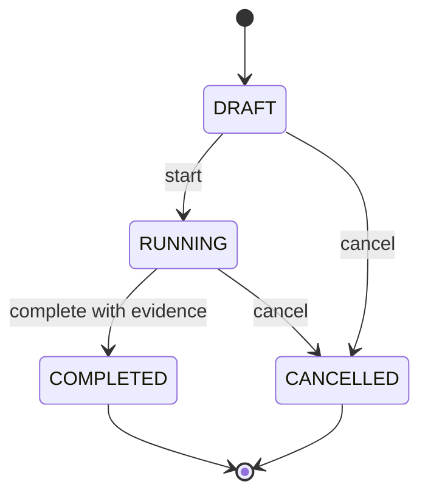

Experiments track `CTR`, `CPC`, `CPA`, and `CONVERSION_RATE`. Variant JSON is bounded, plain, distinct, and rejects secret/prototype/executable/provider-command fields. Only drafts are editable. Completion requires structured samples, metric values, winner classification, source, and analysis window. Statistical significance may be claimed only with an explicitly supplied method and evidence. Experiments do not execute provider changes.

## 16. Settings architecture

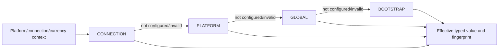

### Approved canonical bootstrap defaults

| Setting | Type/scope | Currency-aware | Default | Main consumers |
|---|---|:---:|---:|---|
| `attributionWindowDays` | Integer, GLOBAL | No | 30 | attribution |
| `recommendationLookbackDays` | Integer, GLOBAL/PLATFORM | No | 14 | recommendations |
| `comparisonLookbackDays` | Integer, GLOBAL/PLATFORM | No | 14 | recommendations |
| `creativeMinimumImpressions` | Integer, GLOBAL/PLATFORM | No | 1000 | scoring/fatigue |
| `minimumClicks` | Integer, GLOBAL/PLATFORM | No | 30 | sufficiency/rules |
| `minimumSignups` | Integer, GLOBAL/PLATFORM | No | 3 | recommendations |
| `minimumPayments` | Integer, GLOBAL/PLATFORM | No | 3 | recommendations |
| `underperformThresholdPct` | Decimal 0-1 | No | 0.30 | rules |
| `scaleThresholdPct` | Decimal 0-1 | No | 0.20 | rules |
| `creativeFatigueThresholdPct` | Decimal 0-1 | No | 0.25 | fatigue |
| `maximumRecommendedScalePct` | Decimal 0-1 | No | 0.20 | recommendation cap |
| `alertCooldownMinutes` | Integer 5-10080 | No | 1440 | general alert cooldown |
| `recommendationEvaluationEnabled` | Boolean, all scopes | No | false | recommendation gate |
| `alertEvaluationEnabled` | Boolean, all scopes | No | false | alert gate |
| `creativeSyncEnabled` | Boolean, all scopes | No | false | creative sync gate |
| `llmCommentaryEnabled` | Boolean, GLOBAL | No | false | reserved only |
| `targetCpa` | Decimal or null | Yes | null | target rules |
| `minimumSpend` | Decimal or null | Yes | null | sufficiency |
| `defaultMarketingAssigneeAdminUserId` | UUID or null | No | null | Task assignment |

Settings writes are atomic and require `expectedVersion`. Stale writes return the established version-conflict code. Monetary settings require an explicit compatible currency. Invalid higher-precedence rows are skipped with bounded warnings. Component toggles cannot override the deployment master flag.

## 17. Scheduler and evaluation architecture

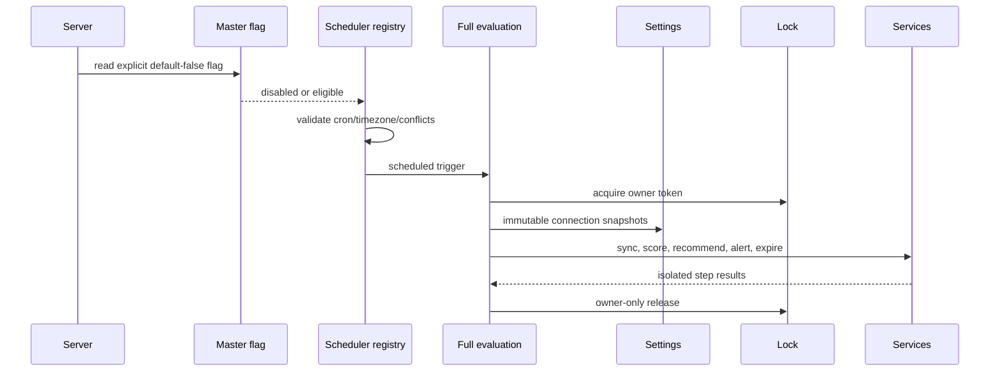

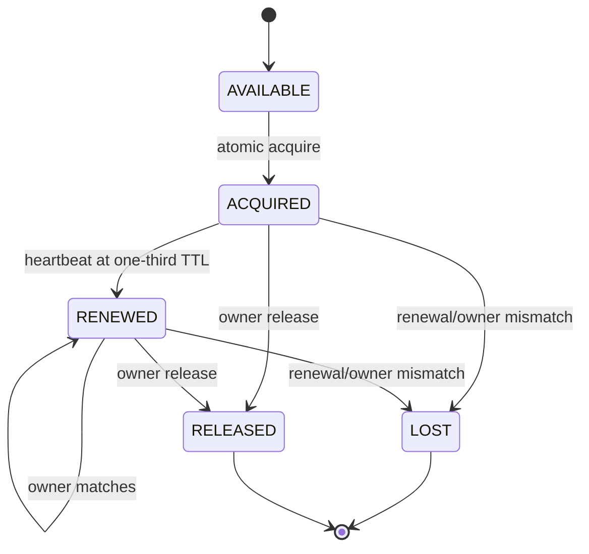

### Eligibility precedence

`master flag AND scheduler registration flag AND effective connection/platform setting AND provider capability AND required live gate`.

### Scheduler flags

| Job | Flag | Default cron/timezone | Lock |
|---|---|---|---|
| Recommendations | `MARKETING_RECOMMENDATION_SCHEDULER_ENABLED` | `15 */6 * * *`, UTC | recommendations |
| Alert health | `MARKETING_ALERT_HEALTH_SCHEDULER_ENABLED` | `5 * * * *`, UTC | alerts:health |
| Alert performance | `MARKETING_ALERT_PERFORMANCE_SCHEDULER_ENABLED` | `30 2 * * *`, UTC | alerts:performance |
| Creative sync | `MARKETING_CREATIVE_SYNC_SCHEDULER_ENABLED` | `30 */6 * * *`, UTC | creative-sync |
| Creative scoring | `MARKETING_CREATIVE_SCORE_SCHEDULER_ENABLED` | `0 1 * * *`, UTC | creative-score |
| Recommendation expiry | `MARKETING_RECOMMENDATION_EXPIRY_SCHEDULER_ENABLED` | `30 2 * * *`, UTC | recommendation-expiry |
| Full evaluation | `MARKETING_FULL_EVALUATION_SCHEDULER_ENABLED` | `0 3 * * *`, UTC | full-evaluation |

Full evaluation and component schedules are mutually exclusive. `SKIPPED_LOCKED`, heartbeat failure, partial success, failure isolation, sanitized summaries, and graceful stop are durable operational behaviors.

## 18. API architecture

The base path is `/api/v1/marketing/intelligence`. There are 26 required Phase 2 endpoints plus 18 legitimate Phase 1/earlier extensions, for 44 total routes.

### Required 26 endpoints

| Method/path | Purpose | RBAC | Master-disabled behavior | Idempotency/errors |
|---|---|---|---|---|
| GET `/creatives` | list creative assets | VIEW | available | paginated |
| GET `/creatives/:id` | creative detail | VIEW | available | UUID/not found |
| POST `/creatives/sync` | manual creative sync | EDIT | blocked | lock/partial/provider errors |
| POST `/creatives/score` | manual scoring | EDIT | blocked | lock/partial |
| GET `/recommendations` | list recommendations | VIEW | available | paginated |
| GET `/recommendations/:id` | recommendation detail | VIEW | available | UUID/not found |
| POST `/recommendations/evaluate` | manual evaluation | EDIT | blocked | lock/partial |
| PATCH `/recommendations/:id/accept` | accept pending advice | EDIT | blocked | equivalent repeat safe |
| PATCH `/recommendations/:id/dismiss` | dismiss with reason | EDIT | blocked | transition conflict |
| POST `/recommendations/:id/convert-to-task` | atomic Task conversion | EDIT | blocked | returns existing linked Task |
| GET `/alerts` | list alerts | VIEW | available | paginated |
| GET `/alerts/:id` | alert detail | VIEW | available | UUID/not found |
| POST `/alerts/evaluate` | manual alert evaluation | EDIT | blocked | lock/partial |
| PATCH `/alerts/:id/acknowledge` | acknowledge alert | EDIT | blocked | lifecycle validated |
| PATCH `/alerts/:id/resolve` | resolve with reason | EDIT | blocked | lifecycle validated |
| GET `/experiments` | list experiments | VIEW | available | paginated |
| GET `/experiments/:id` | experiment detail | VIEW | available | UUID/not found |
| POST `/experiments` | create draft | EDIT | blocked | strict bounded body |
| PATCH `/experiments/:id` | update draft | EDIT | blocked | version/status checked |
| POST `/experiments/:id/start` | start draft | EDIT | blocked | transition conflict |
| POST `/experiments/:id/complete` | complete running experiment | EDIT | blocked | evidence required |
| POST `/experiments/:id/cancel` | cancel draft/running | EDIT | blocked | reason required |
| GET `/settings` | configured/effective settings | VIEW | available | warnings in metadata |
| PATCH `/settings` | atomic versioned settings | EDIT + ADMIN | available | stale version 409 |
| GET `/evaluation-runs` | list run ledger | VIEW | available | strict filters/sorts |
| GET `/evaluation-runs/:id` | run detail | VIEW | available | sanitized summary |

### Approved 18 extensions

| Method/path | Purpose/RBAC | Master-disabled behavior |
|---|---|---|
| POST `/attribution/clicks` | public rate-limited attribution | available |
| GET `/oauth/:platform/callback` | rate-limited OAuth callback | available |
| GET `/performance` | stored Phase 1 performance, VIEW | available |
| GET `/creatives/:id/scores/latest` | latest score, VIEW | available |
| GET `/creatives/:id/scores` | score history, VIEW | available |
| GET `/provider-validation` | validation status, VIEW | available |
| GET `/connections` | connection administration, EDIT | available |
| GET `/connections/:id` | connection detail, EDIT | available |
| POST `/connections` | connection setup, EDIT | available |
| PATCH `/connections/:id` | connection configuration, EDIT | available |
| POST `/connections/bootstrap` | env preparation, EDIT | available |
| POST `/connections/:id/disable` | disable one connection, EDIT | available |
| POST `/connections/:id/enable` | enable one connection, EDIT | available |
| POST `/connections/:id/test` | bounded connection validation, EDIT | available |
| POST `/connections/:id/validation-evidence` | record operator evidence, EDIT | available |
| DELETE `/connections/:id` | safe connection removal, EDIT | available |
| GET `/oauth/:platform/start` | OAuth preparation, EDIT | available |
| POST `/sync` | independent Phase 1 campaign sync, EDIT | available |

Operationally blocked requests receive HTTP 503 with `MARKETING_INTELLIGENCE_PHASE2_DISABLED`. Authentication and RBAC are evaluated before the feature gate.

## 19. RBAC and audit

Reads use `marketing/intelligence VIEW`; mutations use `EDIT`; settings mutation additionally uses the repository ADMIN-tier policy. Services independently validate active actors for lifecycle, Task, settings, and manual operations.

| Audit family | Trigger | Atomicity | Safe metadata |
|---|---|---|---|
| Manual sync/evaluation | operator action | run mutation plus audit as applicable | IDs, scope, counts, status |
| Recommendation lifecycle | accept/dismiss/convert | transactionally paired | previous/new state, reason code, IDs |
| Alert lifecycle | acknowledge/resolve | transactionally paired | state, actor, bounded reason |
| Experiment lifecycle | create/update/start/complete/cancel | transactionally paired | version/state/changed fields |
| Settings | atomic batch | same serializable transaction | keys/scopes/versions, not values containing secrets |
| Connection validation | operator evidence | durable update plus audit | validation booleans/timestamps |

Audit metadata excludes credentials, raw provider bodies, complete payment references, lock owners, arbitrary request bodies, stacks, and full variant/evidence JSON. Idempotent repeats do not create duplicate transition audits.

## 20. Validation, security, and privacy

- Canonical UUIDs are checked before Prisma access.
- Enums constrain platform, state, rule, metric, sort, direction, and filter values.
- Date-only fields are exact calendar dates; timestamps require explicit timezone.
- UTC queries use start-inclusive/end-exclusive boundaries.
- Pagination and sort fields are bounded allowlists; client input cannot become arbitrary Prisma filters.
- Decimal helpers handle money and ratios; unsafe Number-based money calculations are not used.
- Plain JSON limits are 64 KiB, depth 8, 100 fields, 200 array entries, and 4,000 Unicode characters per string by default.
- Secret/prototype keys, executable metadata, HTML/script/control content, buffers, and oversized values are rejected or sanitized.
- Response serialization recursively excludes tokens, credential envelopes, authorization material, raw provider payloads, lock owners/hashes, stacks, and database URLs.
- Public ingestion remains rate-limited; internal funnel ingestion remains authenticated.
- Optional LLM commentary cannot send data or alter deterministic recommendations because no LLM adapter exists.

## 21. Error handling and observability

| Code/family | HTTP | Retryable | Use |
|---|---:|:---:|---|
| `MARKETING_INTELLIGENCE_PHASE2_DISABLED` | 503 | No | deployment kill switch |
| `PROVIDER_UNAVAILABLE` | 503 | Yes | timeout/temporary provider failure |
| `PROVIDER_PERMISSION_DENIED` | 403 | No | provider permission |
| `TOKEN_REFRESH_FAILED` | 503 | Yes | authorization refresh |
| `LOCK_CONFLICT` | 409 | Yes | existing owner |
| `LOCK_OWNERSHIP_LOST` | 409 | Yes | heartbeat/owner mismatch |
| `INSUFFICIENT_DATA` | 422 | No | evidence boundary |
| `INVALID_TRANSITION` | 409 | No | lifecycle state |
| `DUPLICATE_ACTION` | 409 | No | immutable identity conflict |
| `PARTIAL_SUCCESS` | 200 | Yes | independent scope failures |
| `VALIDATION_ERROR` | 400 | No | request contract |
| `NOT_FOUND` | 404 | No | resource missing |
| `FORBIDDEN` | 403 | No | actor/RBAC |
| `RATE_LIMITED` | 429 | Yes | request/provider limit |
| `STALE_VERSION` | 409 | No | settings concurrency |
| `SETTING_INVALID` | 400 | No | setting bounds/scope |
| `TASK_INTEGRITY_CONFLICT` | 409 | No | missing linked Task |

Structured events cover sync start/completion, provider failures, lock outcomes, scoring, recommendation/alert evaluation, Task conversion, provider fetch/token refresh, run completion, and scheduler status. Records contain timestamp, stable event, safe IDs/scope/status/counts/duration, provider category, retryability, and validated request IDs where available. Secrets and raw bodies are excluded.

Provider categories are `AUTHENTICATION`, `PERMISSION`, `RATE_LIMIT`, `TIMEOUT`, `UNAVAILABLE`, `INVALID_REQUEST`, `PROVIDER_DATA`, and `UNKNOWN`.

## 22. Testing architecture

| Suite | Main coverage |
|---|---|
| Attribution | identity, windows, signup/payment/refund/chargeback, dedupe |
| Connectors | five contracts, pagination, refresh, micro-units, sanitization |
| Creative | upserts, normalization, scoring, sufficiency, fatigue |
| Recommendations | rules, confidence, lifecycle, dedupe, expiry |
| Tasks | transaction, row lock, assignee, idempotency, audit, delivery |
| Alerts | rules, cooldown, persistence, recovery, delivery/no-spam |
| Experiments | bounded variants, lifecycle, immutability, no execution |
| Settings | types, scopes, currency, defaults, versions, actor policy |
| Jobs | master flag, schedules, locks, heartbeat, full evaluation, runs |
| Security | privacy, redaction, strict validation, provider-write absence |
| Migrations | manifest canonicalization, ordering, safety, replay/drift |
| Network | blocks live provider/DNS/socket access in tests |
| Documentation | canonical files, diagrams, WP/provider/default/Task accuracy |

Provider tests use injected mocks. The runtime network guard blocks external HTTP, HTTPS, fetch, axios transports, DNS, public IPs, provider hosts, metadata endpoints, and unregistered sockets while allowing registered local test services and the configured local database.

## 23. Deployment architecture

### Environment controls

- `MARKETING_INTELLIGENCE_PHASE2_ENABLED=false` is the master default.
- `MARKETING_LIVE_VALIDATION_ENABLED=false` protects the manual validation CLI.
- Every scheduler registration flag defaults false.
- Provider credentials remain encrypted/configured outside documentation.
- Phase 1 `MARKETING_INTELLIGENCE_SYNC_ENABLED` is independent.

### Deployment sequence

1. Validate the admin database target.
2. Verify the canonical migration manifest.
3. Deploy the 21 ordered manual migrations.
4. Run schema assertions and empty-database replay in the release environment.
5. Deploy code with master false and schedulers false.
6. Confirm reads/settings/connection preparation and Phase 1 behavior.
7. Perform one explicit provider live gate.
8. Advance only that connection through rollout stages.

Graceful shutdown stops Social workers, Phase 2 registry jobs, and Phase 1 sync, waits for tracked callbacks, disconnects databases, and preserves run/lock evidence. Rollback first disables the master and component scheduler flags; historical data is not deleted or migration-reversed.

## 24. Six-stage rollout

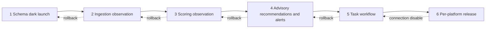

| Stage | Enabled | Prerequisites/exit criteria | Rollback | Owner/status |
|---|---|---|---|---|
| 1 Schema dark launch | migrations; master/schedulers false; reads/settings/setup | replay, no drift/leaks, Phase 1 unaffected | keep master false | Platform + DBA / READY |
| 2 Ingestion observation | master true; one validated connection creative sync | stable IDs/currency/counts/pagination/no duplicates | disable connection or creative sync | Marketing Ops / PENDING |
| 3 Scoring observation | sync and scoring only | sufficiency/score/fatigue review; no fabricated metrics | disable scoring schedule | Analytics / PENDING |
| 4 Advisory | recommendations/alerts; no provider writes | currency targets, quality, cooldown/no-spam review | disable business toggles | Marketing + Support / PENDING |
| 5 Task workflow | accepted recommendations may create Task | eligible assignee, transaction/idempotency/audit/delivery | disable conversion via master or connection | Operations / PENDING |
| 6 Platform release | only platforms with passed live gate | no critical blocker; monitoring/rollback active | disable affected connection/platform | Release owner / PENDING |

## 25. Live-provider validation

No live provider was contacted while producing this document. Automated mocks do not satisfy a live gate. Current machine-readable status is `docs/marketing-intelligence-phase2-live-validation-status.json`.

### Safety command

```powershell
$env:MARKETING_LIVE_VALIDATION_ENABLED='true'
npm run marketing:live-validate -- --confirm-live --platform=META --connection-id=11111111-1111-4111-8111-111111111111 --from=2026-07-01 --to=2026-07-02 --account=act_123
```

Replace values only after an authorized operator confirms provider, connection, bounded account, maximum seven-day range, read-only operation, redacted destination, and incident owner. Run one provider at a time. Never run under `NODE_ENV=test`.

### Gate checklist

1. Connection test.
2. One bounded account/date range.
3. Pagination behavior.
4. Rate-limit classification from safe evidence, never by intentionally exhausting quota.
5. Campaign totals reconciled with Phase 1 and documented provider definitions.
6. Repeated stable creative/ad identities.
7. Currency and micro-unit reconciliation.
8. Sanitized raw-storage review.
9. Normalized catalog/insight row counts.
10. Removed-provider assets remain historical.
11. Scoring observation review.
12. Recommendations/alerts only after sufficient history.
13. Approval/capability limitation recorded.

The CLI records only bounded counts, statuses, categories, and blockers. It does not persist credentials, headers, raw bodies, or encrypted credential envelopes. A successful CLI subset remains `LIVE_VALIDATION_IN_PROGRESS` until operator reconciliation and approval complete the entire gate.

## 26. Operations runbook

### Start and verify

1. Run configuration validation.
2. Confirm master and scheduler values without printing secrets.
3. Start the existing server process.
4. Inspect structured scheduler registration events.
5. Query evaluation runs and provider validation status.

### Stop and rollback

1. Set `MARKETING_INTELLIGENCE_PHASE2_ENABLED=false`.
2. Set all Phase 2 scheduler flags false.
3. Restart or gracefully stop the process so registrations are removed.
4. Disable an affected connection through its existing endpoint when isolation is sufficient.
5. Keep Phase 1 sync enabled if healthy.
6. Preserve all settings, runs, scores, recommendations, alerts, experiments, Tasks, Notifications, and audits.

### Incident evidence

Collect run ID, connection/platform ID, trigger, status, safe provider category/code, retryability, counts, duration, lock outcome, scheduler configuration source, deployment version, and operator timeline. Do not collect credentials, headers, raw responses, payment PII, stack dumps, or lock-owner tokens.

### Credential rotation

Disable the connection, rotate/re-authorize using provider setup, run the controlled connection/live gate, record evidence, then re-enable only after approval. Do not copy credential values into tickets or documents.

### Alert-spam response

Disable alert evaluation for the scoped connection/platform, inspect dedupe/cooldown/occurrence data, correct settings if necessary with optimistic concurrency, and re-enable in observation mode. Do not delete historical alerts.

## 27. Troubleshooting guide

| Symptom | Diagnosis | Safe response |
|---|---|---|
| Feature disabled | master false | confirm intended stage; do not bypass with component flag |
| Authentication failed | provider category AUTHENTICATION | disable connection and rotate/re-authorize |
| Permission denied | provider category PERMISSION | confirm account/app approval |
| Rate limited | RATE_LIMIT/retryable | respect backoff; reduce page/range frequency |
| Token refresh failed | refresh category/code | rotate credentials; preserve sanitized evidence |
| Sync stale | latest successful fetch outside threshold | inspect scheduler/master/connection/run ledger |
| Lock conflict | another valid owner | wait; inspect run; do not delete lock blindly |
| Lock ownership lost | heartbeat failure/owner mismatch | stop unsafe continuation; inspect duration/DB health |
| Partial success | independent scope failure | retain successes; retry only failed idempotent scope |
| No eligible data | sufficiency/target/currency unavailable | configure data/target; never invent zero |
| Missing target CPA | currency-specific target absent | create scoped currency setting |
| No eligible assignee | request/config/fallback unavailable | configure active eligible admin |
| Notification failure | alert/Task persisted, delivery failed | retry operational delivery; do not roll back history |
| Realtime failure | post-commit delivery failed | inspect Socket.IO health; durable record remains |
| Manifest mismatch | migration content/order changed | stop release; reconcile without rewriting applied SQL |
| Schema drift | replay/assertion differs | stop rollout; determine additive corrective migration |

## 28. Risk register

| Risk | Likelihood/impact | Owner | Early warning | Controls/mitigation | Contingency | Residual/current state |
|---|---|---|---|---|---|---|
| Creative API unavailable/approval-limited | High/High | Platform owner | permission/capability status | explicit capability matrix, isolated provider failure | keep platform disabled | High / pending live gate |
| Attribution ambiguity | High/High | Analytics | campaign-only/unknown evidence | deterministic precedence, no creative duplication | report unavailable | Medium / controlled |
| Cross-currency misuse | Medium/High | Finance/Analytics | mixed-currency flag/null metric | currency identity, Decimal, no FX | disable monetary rule | Low / controlled |
| Provider API version drift | High/Medium | Platform owner | provider data/error category | version config, normalized contract, mocks | disable affected connector | Medium / monitored |
| Rate limits/pagination | High/Medium | Platform owner | 429/cursor/retry telemetry | bounded pages/ranges, retry policy | reduce frequency | Medium / live pending |
| Duplicate recommendations/Tasks | Medium/High | Backend | uniqueness/serializable conflicts | dedupe keys, row lock, one-to-one Task link | return existing record | Low / tested |
| Alert spam | Medium/High | Marketing Ops | occurrence/delivery volume | active dedupe, cooldown, persistence/recovery | disable scoped alerts | Low / observation pending |
| Lock expiry during long run | Medium/High | SRE | renewal failure | one-third TTL heartbeat, owner checks | stop run, increase reviewed TTL | Low / tested |
| PII/secret logging | Medium/Critical | Security | secret scan/redaction alert | bounded structured logs/serializers | disable workload, rotate credentials | Low / scans clean |
| Organic/paid coupling | Medium/High | Architecture | cross-module imports/actions | separate domains and schedules | disable affected module | Low / enforced |
| Sparse data | High/Medium | Analytics | insufficiency distribution | sufficiency states/null metrics | extend observation window | Medium / expected |
| Mock-only confidence | High/Medium | Release owner | live status not passed | honest status artifact/live gate | stage 1 only | High / current blocker |
| Migration conflict | Low/High | DBA | manifest/replay failure | immutable ordered manifest and replay | stop deploy/add correction | Low / verified |
| Phase 3 scope creep | Medium/Medium | Product/Architecture | new mutation/model/LLM dependency | locked non-goals/static tests/review | remove or separately approve | Low / absent |

### Risk-to-control examples

| Risk | Code control | Operational control | Test/monitoring | Remaining exposure |
|---|---|---|---|---|
| Alert spam | dedupe/cooldown/recovery | scoped disable and review | alert tests/evaluation telemetry | live thresholds |
| Secret logging | redaction/bounded serializer | credential handling policy | secret scan/log tests | provider SDK changes |
| Duplicate Task | row lock/unique link | idempotent operator retry | Task concurrency tests/audit | database outage race |
| Rate limit | classifier/retry cap | bounded validation window | connector mocks/provider failure logs | actual quota |
| Mock-only confidence | status gate | per-provider approval | network guard + live artifact | external credentials |

Review risks before each rollout-stage exit and after any provider API/version, schema, credential, or incident change.

## 29. Final Definition of Done

| Requirement | Status | Code/test evidence | Live evidence/blocker |
|---|---|---|---|
| Mandatory Phase 1 corrections | COMPLETE | WP0/attribution/revenue tests | source-app coverage remains external |
| Five creative connector contracts | LIVE_VALIDATION_PENDING | registry/provider mock tests | credentials/approval required |
| Durable/account-aware/idempotent creative history | COMPLETE | schema/upsert/scoring tests | observation pending |
| Deterministic configurable classification | COMPLETE | settings/rule/Decimal tests | quality review pending |
| Recommendation lifecycle and atomic Task conversion | COMPLETE_WITH_CONFIGURATION | recommendation/Task tests | assignee/operational verification |
| Alert lifecycle/delivery/no-spam | COMPLETE_WITH_CONFIGURATION | alert tests | cooldown observation |
| Tracking-only experiments | COMPLETE | experiment/security tests | no live execution applicable |
| Lock-safe isolated evaluation | COMPLETE | scheduler/lock/run tests | stage observation pending |
| RBAC/audit/privacy/rate limits/Decimal | COMPLETE | security/network suites | none |
| Prisma/migrations/manifest/quality gates | COMPLETE | release commands | deployment environment must repeat |
| Documentation reflects five platforms/policies | COMPLETE | documentation tests and this document | none |
| No Phase 3 model/provider mutation | COMPLETE | static tests/source audit | none |

**Final engineering verdict:** `PHASE2_ENGINEERING_COMPLETE_LIVE_VALIDATION_PENDING`.

Lint is `SCRIPT_NOT_DEFINED`; the repository has no configured lint framework. Build is `NOT_APPLICABLE` for this plain-JavaScript backend; Prisma generation, syntax checks, static security checks, and tests are the build-equivalent gates.

## 30. Appendices

### 30.1 State and enum summary

- Platforms: META, TIKTOK, X, LINKEDIN, GOOGLE_ADS.
- Recommendation states: PENDING, ACCEPTED, DISMISSED, EXPIRED, CONVERTED_TO_TASK.
- Alert states: OPEN, ACKNOWLEDGED, RESOLVED; severities INFO, WARNING, CRITICAL.
- Experiment states: DRAFT, RUNNING, COMPLETED, CANCELLED.
- Run outcomes include STARTED, SUCCEEDED, PARTIAL_SUCCESS/PARTIALLY_SUCCEEDED, FAILED, SKIPPED_LOCKED, and lock-renewal failure.
- Creative sufficiency: INSUFFICIENT, LIMITED, SUFFICIENT, STRONG; fatigue: NONE, WATCH, FATIGUED, RECOVERED.

### 30.2 Migration inventory

1. `20260705_add_marketing_campaigns_content.sql`
2. `20260705_add_marketing_email_templates_social.sql`
3. `20260705_add_marketing_promotions_banners_analytics.sql`
4. `20260714_add_marketing_intelligence_phase1.sql`
5. `20260715_add_marketing_connection_token_expiry.sql`
6. `20260716_add_marketing_attributions_phase1.sql`
7. `20260716_add_social_operations_section_5.sql`
8. `20260717_212000_migrate_legacy_marketing_social_records.sql`
9. `20260717_extend_marketing_ad_platforms.sql`
10. `20260717_make_task_assignee_nullable_for_safety.sql`
11. `20260718_add_marketing_connection_credentials_currency.sql`
12. `20260718_ensure_social_operations_partial_indexes.sql`
13. `20260719_finalize_marketing_intelligence_connections.sql`
14. `20260720_fix_marketing_intelligence_currency_width.sql`
15. `20260721_marketing_intelligence_wp0_corrections.sql`
16. `20260722_marketing_intelligence_phase2_section7_schema.sql`
17. `20260723_marketing_intelligence_phase2_section8_raw_ingestion.sql`
18. `20260724_marketing_intelligence_phase2_section9_scoring_enums.sql`
19. `20260725_marketing_intelligence_phase2_sections10_13.sql`
20. `20260726_marketing_intelligence_sections10_13_audit_corrections.sql`
21. `20260727_marketing_intelligence_sections14_17.sql`

### 30.3 Major file inventory

| Area | Actual path | Responsibility | Principal tests |
|---|---|---|---|
| Routing/controller | `src/modules/marketing/intelligence/intelligence.routes.js`, `intelligence.controller.js` | API, RBAC, validation, envelopes | route/authz tests |
| Master flag | `src/modules/marketing/intelligence/phase2-feature.js` | deployment kill switch and stable disabled results | Sections 22-26 |
| Connections/connectors | `provider-connections.service.js`, `connectors/` | credentials, OAuth, campaign reads | provider tests |
| Creative | `creative/` | registry, normalization, sync, snapshots, scoring, fatigue | creative tests |
| Attribution | attribution/funnel/listener/event files | internal truth and adjustments | attribution/WP0 tests |
| Recommendations | `recommendations/` | settings, inputs, rules, confidence, lifecycle, Tasks | recommendation/Task tests |
| Alerts | `alerts/` | rules, lifecycle, delivery, recovery | alert tests |
| Experiments | `experiments/` | tracking lifecycle | experiment tests |
| Settings | setting registry/service/validators | typed precedence/versioning | Sections 14-17/22-26 |
| Scheduling | `scheduling/`, full evaluation, run ledger | jobs, orchestration, locks, summaries | scheduler/lock tests |
| Security/observability | validation, serializer, errors, observability | privacy and stable operations | Sections 18-21 |
| Live validation | `scripts/marketing-intelligence/live-validate-provider.js` | explicit one-provider read-only gate | Sections 22-26 |

### 30.4 Quality commands

```powershell
npx prisma validate --schema=prisma/schema.prisma
npx prisma generate --schema=prisma/schema.prisma
npm run db:manifest:generate
npm run db:manifest:verify
npm run migrations:safety
npm run db:admin:guard
npm run db:schema:assert
npm run db:replay:verify
npm run config:validate
npm run security:secret-scan
npm run security:audit-policy
npm run security:network-guard-static
npm run test:network-guard
npm run security:static-social
npm run test:social-operations
npm test
git diff --check
```

### 30.5 Final checklist

- [x] Git baseline recorded; staging branch preserved.
- [x] Correct Admin Prisma client and existing infrastructure reused.
- [x] WP0-WP12 reconciled.
- [x] Master flag default false and tested.
- [x] Approved defaults reconciled.
- [x] Five provider code capabilities documented.
- [x] Controlled live-validation tool and sanitized status artifact created.
- [x] Provider writes and Phase 3 models absent.
- [x] Six-stage rollout, rollback, operations, troubleshooting, and risks documented.
- [ ] Meta live gate passed.
- [ ] TikTok live gate passed.
- [ ] X live gate passed.
- [ ] LinkedIn live gate passed.
- [ ] Google Ads live gate passed.

### 30.6 Glossary

- **Capability:** A connector operation demonstrably implemented in code; it is not proof of provider approval.
- **Live gate:** Authorized evidence that one configured connection works against the real provider within a bounded read-only scope.
- **Observation mode:** Data collection/scoring without downstream recommendation, alert, or Task activation.
- **Provider conversion:** Provider-reported informational conversion, distinct from trustworthy internal funnel truth.
- **Run ledger:** Durable sanitized operational history for manual and scheduled evaluations.
- **Master flag:** Deployment kill switch that cannot be bypassed by scheduler or business toggles.
