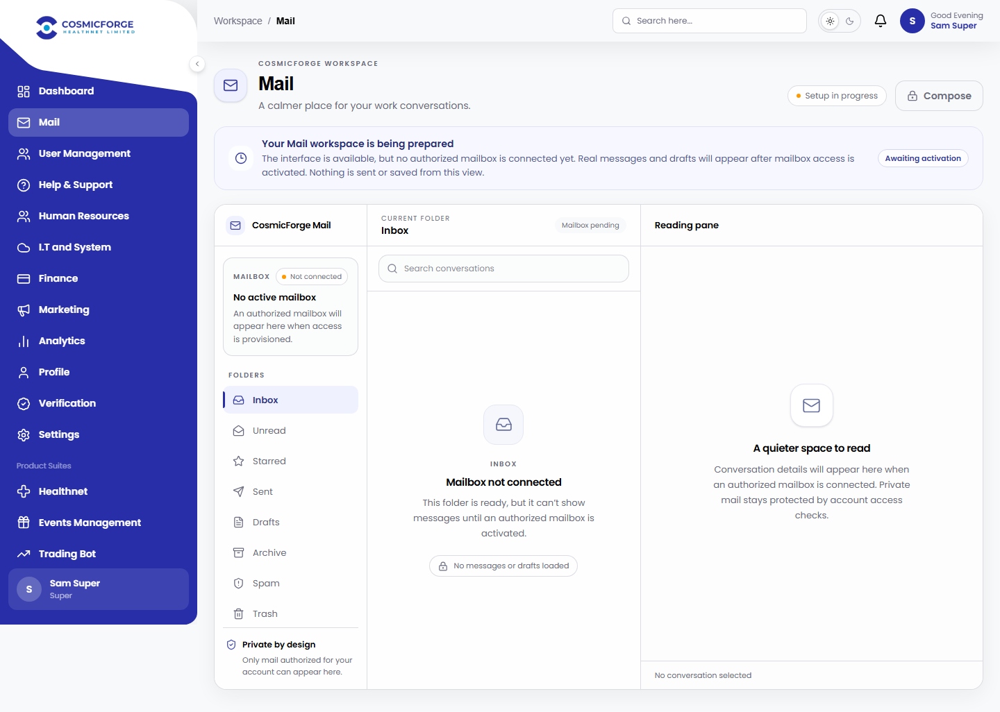
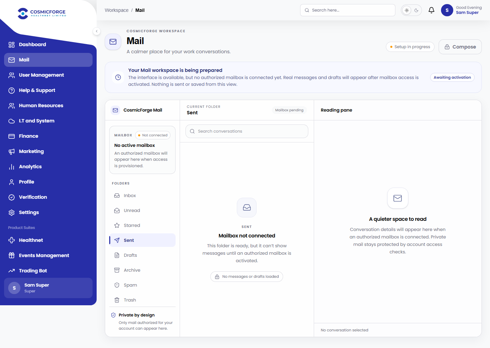
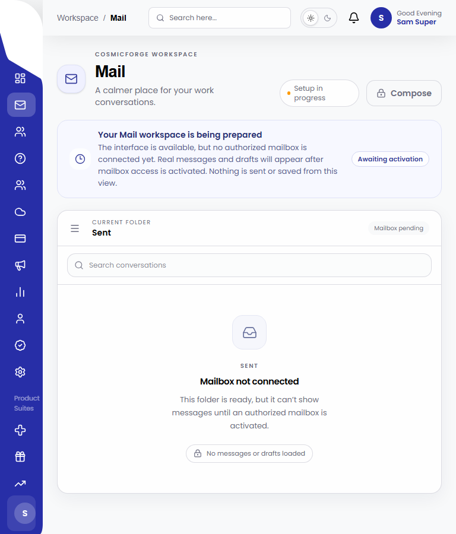
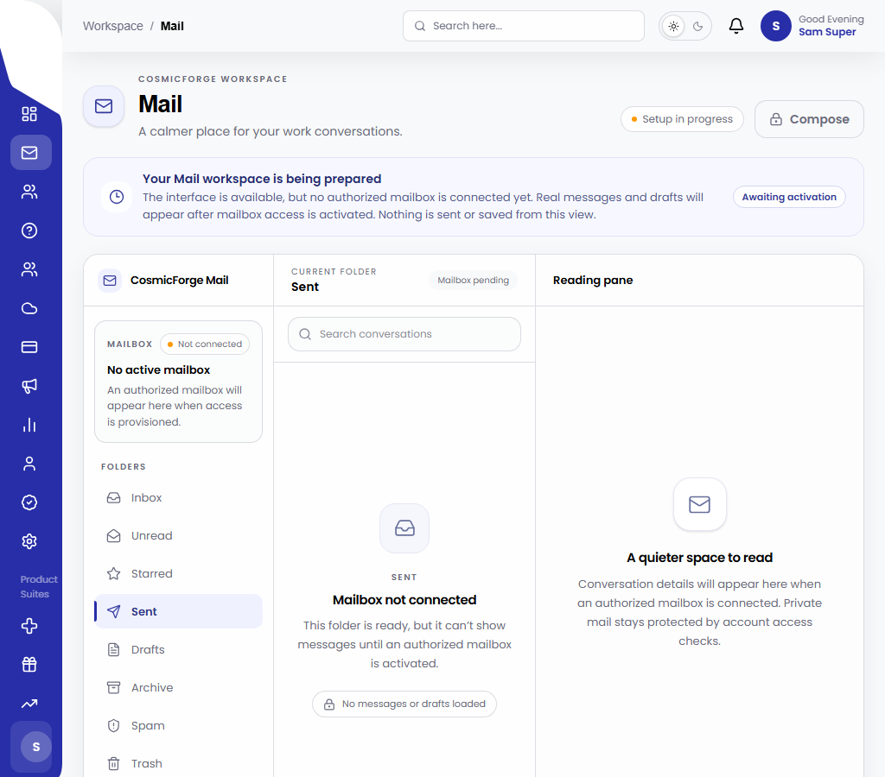
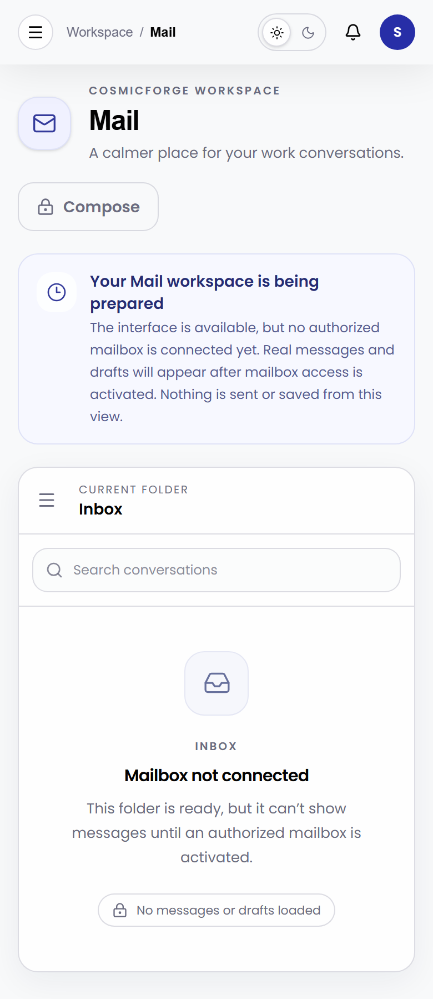
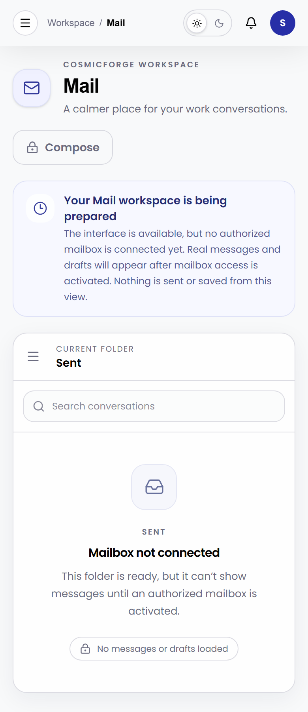
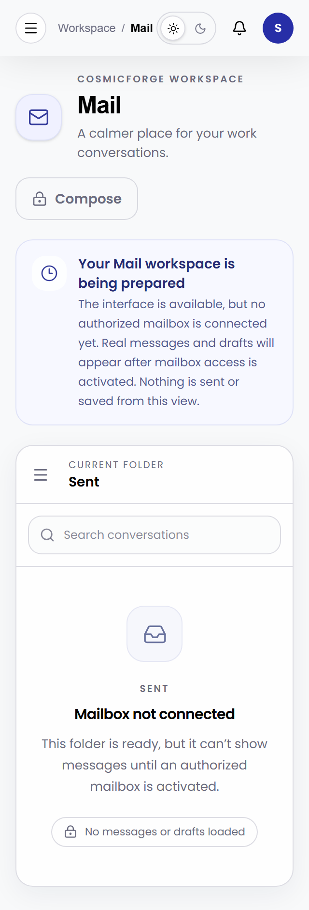

# CosmicForge Mail UI refresh

**Status:** implemented, pushed to staging and CI-verified with the Mail-disabled test state; live authenticated acceptance remains separate.
**Route:** `/dashboard/mail`
**Test state:** authenticated synthetic E2E reviewer with the Mail API returning `MAIL_DISABLED`. The screenshots contain no real inbox data and are not screenshots of a signed-in live staging account.

## What changed

The earlier pending view used a basic alert strip and plain folder rows, while the three panes had little hierarchy or separation and the mobile layout did not offer a compact, deliberate workspace. The refreshed pending shell now uses CosmicForge's existing indigo and neutral palette, clearer title and service-status hierarchy, a quieter activation banner, a mailbox identity/status block, better grouped folders, disabled-but-explained search and compose controls, and distinct conversation-list and reading-pane empty states.

At desktop widths the workspace presents the folder navigation, conversation list and reading pane together. At tablet and phone widths the folder navigation moves into a drawer, with focus containment, Escape-to-close, focus restoration and background scroll lock. The selected folder remains visible in the list pane. All folders show the same honest pending state; no mailbox, count, message or draft is invented. Compose and search remain unavailable until mailbox access is active.

## Files

- `apps/central-admin-web/src/components/mail/MailAwaitingActivation.tsx` — redesigned Mail workspace and responsive navigation.
- `apps/central-admin-web/e2e/mail-unconfigured-staging.spec.ts` — disabled-state assertions, keyboard drawer checks, axe scan, responsive overflow checks and screenshot capture.
- `docs/assets/mail-ui-refresh/` — deterministic test screenshots at desktop, tablet and phone widths.

## Visual evidence

Screenshots were captured from the production Next.js build served locally with the existing Playwright API fixture. They show the real component and dashboard shell under the honest `MAIL_DISABLED` state, using the test-only `SUPER_USER` identity. The live staging route still requires a real authorized login for a live-session review.

| View | Evidence |
|---|---|
| Desktop, Inbox and empty reading pane |  |
| Desktop, Sent selected |  |
| Tablet, 768 px |  |
| Tablet, 1024 px |  |
| Mobile, 390 px |  |
| Mobile, 390 px, Sent selected |  |
| Narrow mobile, 320 px |  |

## Verification

- `npm run lint` — exit 0; existing repository-wide warnings remain (198 warnings, 0 errors).
- `npx eslint src/components/mail/MailAwaitingActivation.tsx e2e/mail-unconfigured-staging.spec.ts` — pass with no warnings.
- `npx tsc --noEmit --pretty false` — pass.
- `npm run build` with `NEXT_PUBLIC_API_URL=http://localhost:4999` and `NEXT_PUBLIC_STAGING_MAIL_NAV_ENABLED=true` — pass; all app routes generated. Next.js reported the existing `middleware` to `proxy` deprecation warning.
- `npm run test:e2e -- e2e/mail-unconfigured-staging.spec.ts` with the staging UI flag enabled — **4 passed** across desktop and mobile Chromium, including privileged pending state, non-privileged denial, drawer keyboard behavior, zero Mail mutations/data-list calls, axe scan, and no horizontal overflow at 320, 375, 390, 768, 1024, 1280 and 1440 px.
- Screenshots were visually inspected after rendering. The Mail panes, pending banner, selected-folder states and phone reflow were legible and unclipped at the captured sizes.

## Staging publication and deployment-safety evidence

- Frontend commit reviewed by these checks: `27aacab0743ad7e90c796c83a9a1b27f942dc38d` (`feat(mail-ui): polish staging workspace pending state`). The commit contains only the Mail disabled-state component, its E2E coverage, screenshots and this report.
- [Centralized Admin Frontend CI](https://github.com/CosmicforgeHealthnet/centralize-admin/actions/runs/40372363567) — **PASS**: lint/typecheck/build and mocked Mail Playwright jobs succeeded.
- [Monorepo Layout and Container CI](https://github.com/CosmicforgeHealthnet/centralize-admin/actions/runs/40372363439) — **PASS**: boundary verification and compatibility image build succeeded; this job did not publish or deploy an image.
- [Social Operations CI](https://github.com/CosmicforgeHealthnet/centralize-admin/actions/runs/40372363350) — **PASS**: backend verification succeeded.
- [Staging workflow](https://github.com/CosmicforgeHealthnet/centralize-admin/actions/runs/40372363349) — **PASS**: the exact push range (`a88440ad64e36ea5a1f8e16c0c2bbd3e8c03619d` to `27aacab0743ad7e90c796c83a9a1b27f942dc38d`) was classified as `API deployment source changes detected: false`. `Verify Contabo SSH key and staging account`, `Publish immutable staging API image`, and `Deploy staging API to Contabo and verify login` were all **skipped**.
- Staging CI's schema setup used its workflow-local PostgreSQL 16 service container and `localhost` test URL. No VPS database was migrated or API container restarted/replaced.
- [Vercel staging frontend deployment](https://vercel.com/cosmicforgedevteamgmailcoms-projects/centralize-admin-staging/5SXByZwVyN792FVEhcJK57HSCiR6) — **READY** for branch `staging`, commit `27aacab0743ad7e90c796c83a9a1b27f942dc38d`, project `centralize-admin-staging`.

## Acceptance limits and deployment

- Mail remains disabled; no backend activation, API deployment, API restart, migration, send/receive, or credential change was made.
- The actual staging URL still redirects unauthenticated visitors to sign-in. No authorized live staging session was available, so live-account visual and functional acceptance remains pending.
- The automated keyboard test covers the folder drawer and its focus behavior. A manual screen-reader audit was not available and is still an acceptance item.
- Existing local-only backend readiness changes were preserved and excluded from the frontend-only commit; they remain uncommitted in the local worktree.
